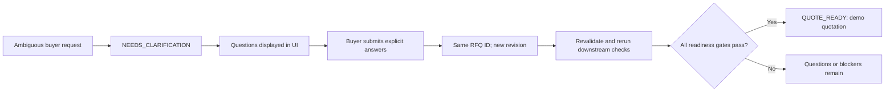
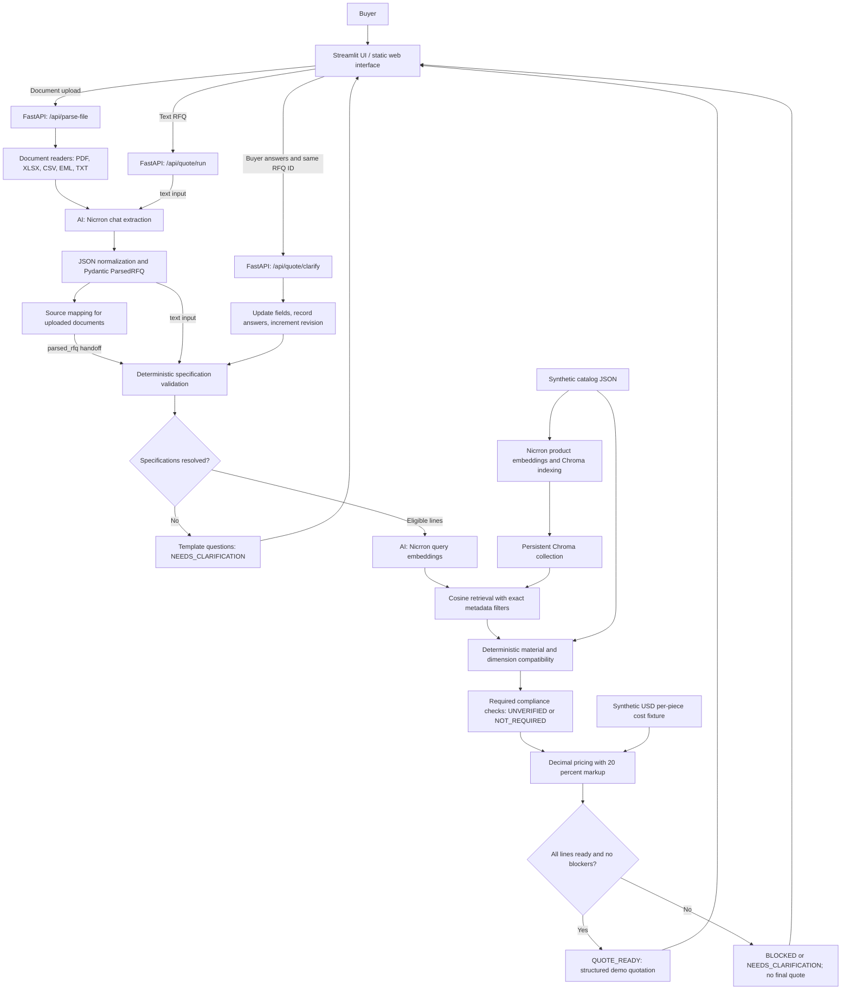

# RFQFlow

**AI-Powered Industrial RFQ-to-Quote Agent**

RFQFlow turns messy industrial buyer requests into structured specifications, supplier matches, clarification questions, and reproducible demo quotations. Built for **Track 2 — RudCo | RFQ to Quote** at **Get Hired Hack @ Columbia Startup Lab**.

> **DEMO DATA — Synthetic supplier pricing.** The catalog and supplier costs are fictional. Market competitiveness is not established by the current prototype. Quotations do not establish supplier availability, certification, or delivery commitments.

## Overview

The integration branch contains an end-to-end Python prototype: a Streamlit buyer interface, FastAPI endpoints, Nicrron extraction and embeddings, persistent Chroma retrieval, and a deterministic quotation workflow.

For complete specifications, RFQFlow retrieves catalog candidates, checks material and dimensional compatibility, applies a documented pricing policy, and returns a structured quotation when its readiness gates pass. For incomplete specifications, it returns questions and resumes the same RFQ after buyer answers. Requested compliance without supporting evidence blocks the final quotation.

**Current scope:** sheet and plate products, a six-product synthetic catalog, USD per-piece prices, and a 20% markup on cost. `QUOTE_READY` means a **demo quotation passed the implemented gates**, not a production purchasing or engineering approval.

Navigation: [RudCo requirements](#how-rfqflow-solves-rudcos-five-requirements) · [Architecture](#system-architecture) · [Demos](#demo-scenarios) · [Local setup](#running-locally) · [API](#api-endpoints) · [Tests](#testing-and-validation) · [Limitations](#limitations-and-future-work)

## The Problem

Industrial RFQs arrive as emails, PDFs, spreadsheets, and free-form text. Buyers describe the same material using abbreviations, gauges, fractions, and different dimension conventions:

```text
304 SS sheet 16ga 4x8
Stainless 304, 0.060 in, 48 x 96
```

A salesperson must determine what was requested, find compatible supplier products, obtain prices, check standards and certificates, and resolve uncertainty. Guessing a dimension unit or equating similar grades can produce the wrong quotation. A plausible answer is insufficient: each decision needs an identifiable source and a clear indication of what remains unknown.

## Our Solution

RFQFlow separates language interpretation from business decisions:

- **AI extraction** interprets the buyer's wording and proposes structured line items.
- **Validation and clarification** preserve raw values, normalize supported explicit units, and ask the buyer to resolve missing specifications.
- **Retrieval** finds sourced supplier candidates; similarity does not approve them.
- **Deterministic checks** select products with matching material, grade, form, and dimensions.
- **Decimal pricing and compliance gates** produce a traceable demo quote or explicit blockers.

The application is a **deterministic orchestrator with LLM-powered extraction**, not an autonomous multi-agent system. It does not let an LLM invent prices, choose arbitrary tools, or declare certifications verified.

## How RFQFlow Solves RudCo's Five Requirements

| RudCo requirement | Current implementation | Qualification |
| --- | --- | --- |
| 1. Standardize RFQ lines | Multi-format extraction, Nicrron parsing, Pydantic validation, explicit-unit normalization, source references | Implemented and demonstrated for supported inputs; arbitrary document layouts and exhaustive extraction fidelity remain partial |
| 2. Match supplier catalog items | Nicrron embeddings, Chroma cosine search, exact categorical filters, deterministic compatibility checks | Implemented and tested against a synthetic catalog; real supplier integration is missing |
| 3. Price against market benchmarks | Sourced synthetic costs, 20% markup, Decimal arithmetic, structured price explanation | Demo pricing is implemented and tested; live benchmarking and competitive-price assessment are **not implemented** |
| 4. Flag compliance requirements | Requested ASTM, MTR, certification and origin requirements; `UNVERIFIED` checks and quote blockers | Requirement flagging/blocking is implemented; actual supplier certificate verification is **not implemented** |
| 5. Return ambiguous lines to the buyer | Targeted questions, answer submission, preserved RFQ/line IDs, revisions and resumed evaluation | Implemented and tested in the application; external email/message delivery is **not implemented** |

### 1. Parse RFQs into standardized specifications

[Document ingestion](backend/app/ingestion/document_reader.py) supports:

| Input | Extraction behavior |
| --- | --- |
| Pasted text / TXT | Text content; uploaded TXT uses UTF-8 with BOM support |
| EML | Email subject and readable body; prefers plain text and falls back to HTML text |
| PDF | PyMuPDF text extraction by page; image-only PDFs require OCR and are rejected |
| XLSX | openpyxl reads worksheets, treating the first row as headers and subsequent rows as data |
| CSV | Python `csv.DictReader` reads header-based rows |

[The parser](backend/app/ingestion/parser.py) sends extracted content to Nicrron's chat completion API. Its prompt requests material family, grade, form, quantity/unit, raw thickness and dimensions, requested standard, certifications, and country-of-origin requirements. Plural product forms such as `sheets` and `plates` normalize to singular forms.

The parser checks source support for selected fields, validates positive integral extracted quantities, and builds a `ParsedRFQ`. It converts supported explicit inch/mm thickness measurements and supported inch/mm/foot dimension pairs into inches. Fractions such as `1/4 in` are supported. Unknown units and gauge thickness remain unresolved. Missing fields and warnings remain visible.

For example:

```text
20 pcs 304 SS sheet 16ga 4x8
```

The demonstrated extraction identifies stainless steel, grade 304, sheet, and 20 pieces. It preserves `16ga`, `4`, and `8` as raw measurements. **It does not assume feet, convert gauge into decimal inches, or assign an ASTM standard that was not requested.** The workflow requires clarification of thickness, width, and length.

[Source mapping](backend/app/ingestion/source_mapper.py) retains original excerpts and filenames. It assigns a PDF page only for a unique matching page and spreadsheet sheet/row references only for a unique full-row match. Unmapped spreadsheet rows become unparsed segments and errors. The parser also flags uncovered material-bearing text lines conservatively; this is not a guarantee of complete extraction from arbitrary documents.

### 2. Match supplier catalog items

The [catalog fixture](backend/data/fixtures/retrieval/supplier_catalog.json) contains six fictional stainless-steel, carbon-steel, and aluminum products. Each has a SKU, supplier name, dimensions, source ID/date, and synthetic flag.

`RetrievalIndex.build_index()` embeds product descriptions through Nicrron and stores vectors plus metadata in a local Chroma collection. `retrieve_for_rfq()` accepts `ParsedRFQ` directly. It embeds each eligible line's original text and searches with exact material-family, grade, and product-form filters when those values are present.

Candidates are ranked by **cosine distance: lower is closer**. Distance is not a probability of compatibility. Retrieval reports unresolved dimensions and dimension conflicts while preserving evidence sources and `candidate_only` labels.

The [workflow](backend/app/workflow/service.py) separately checks candidates against the catalog. A selected compatible product must match:

- Material family, material grade, and product form exactly.
- Verified normalized thickness, width, and length.
- Dimensions within `1e-9` inches solely to accommodate numerical roundoff.

That threshold is **not a manufacturing tolerance or substitution policy**. A selected product can still be blocked by missing price or compliance evidence. Chroma search with metadata filters is implemented; SQLite/semantic hybrid retrieval is not.

### 3. Calculate prices and explain their basis

[Demo price fixtures](backend/data/fixtures/retrieval/demo_prices.json) provide USD per-piece supplier costs for the six catalog SKUs. These are fictional costs, not real supplier offers or historical transactions.

The pricing policy is **20% markup on supplier cost**, not a 20% gross margin:

```text
unit selling price = round_to_cents(supplier unit cost × 1.20)
line total         = round_to_cents(unit selling price × quantity)
subtotal           = sum(line totals)
grand total        = subtotal + 0.00 additional charges
```

The implementation uses Python `Decimal` and `ROUND_HALF_UP`. Monetary values are serialized as decimal strings. Each priced line includes supplier unit cost, markup percentage, currency, price unit, synthetic label, and a `SYNTH-PRICE-<SKU>` source ID. Final quote lines retain catalog and original source references.

Streamlit and the static frontend display the **backend's values**; neither calculates quotation totals. Freight and tax are excluded. There are no live market benchmarks or comparable-market-price calculations.

**Market competitiveness is not established by the current prototype.** The API reports: `Market competitiveness not established.` Integrating dated, sourced, commercially comparable benchmarks is future work.

### 4. Flag compliance requirements and missing evidence

A buyer requesting an MTR is different from a supplier having a verified MTR for the supplied material or lot.

The parser retains supported requested standards, certifications, and origin requirements. The workflow also scans original source text for ASTM references, MTR requests, and certain origin expressions so a missed extraction does not automatically remove a compliance requirement.

The catalog contains **no supplier compliance documents**. Required checks therefore return:

```json
{
  "type": "certification",
  "requested": "MTR",
  "status": "UNVERIFIED",
  "evidence": null
}
```

Such a line receives `Required compliance evidence unavailable` as a blocker. Without remaining clarification questions, the overall result is `BLOCKED`, with `final_quotation: null`. Lines with no detected requirements use `NOT_REQUIRED`; this is not certification of the product.

Requirement detection and safe blocking work. Actual document authentication, ASTM conformance verification, country-of-origin verification, and lot/heat traceability remain future integrations. Current source-wide checks are conservative and can apply a requirement more broadly than intended.

### 5. Resolve ambiguity through buyer clarification

The orchestrator generates questions from missing or unresolved specification fields using **deterministic templates**, not another LLM call. Eligible quantity units are `pcs`, `piece`, or `pieces`; quote product forms are `sheet` and `plate`.

For the ambiguous sample, Streamlit displays thickness, width, and length questions under **Buyer clarification**. The buyer can supply:

```text
Thickness: 0.060 in
Width:     48 in
Length:    96 in
```

These are **buyer-provided specifications**, not values inferred from `16ga` or `4x8`. An answer without explicit supported measurement units remains unresolved.

`QuoteWorkflow.clarify()` updates the specified line, preserves the original request and line text, records the submitted answers, increments the revision, validates the updated `ParsedRFQ`, and reruns matching, pricing, compliance and readiness. It uses the same `rfq_id`; there is no separate session-ID field in the API.



## Key Features

- Text input and PDF/XLSX/CSV/EML/TXT uploads.
- AI extraction with raw measurements, missing fields, and source excerpts.
- Clarification and resumption without discarding the original request.
- Persistent supplier vector retrieval with model/dimension consistency checks.
- Separate candidate discovery and deterministic product compatibility.
- Reproducible demo pricing and explicit compliance blockers.
- Structured API output plus Streamlit specification, match, and quotation tables.
- Two sample buttons that populate input and then execute the real API workflow.

## How It Works

1. **Enter or upload an RFQ.** In the Streamlit sidebar, choose **Paste text** or **Upload document**, then select **Process RFQ**. **Load Complete RFQ** and **Load Ambiguous RFQ** populate examples without bypassing processing.
2. **AI extracts specifications.** FastAPI invokes document extraction where needed and Nicrron parsing. Uploads go through `/api/parse-file`, followed by `/api/quote/run` with the returned `parsed_rfq`; no second extraction discards their provenance.
3. **Review extracted items.** **Extracted specifications** shows material, grade, form, raw measurements, quantity/unit, standard, certifications, extraction status, and available source location. **Source text and extraction warnings** exposes supporting details.
4. **Resolve ambiguity.** **Buyer clarification** displays backend questions. **Submit Clarifications** submits nonempty answers to the existing RFQ; unanswered fields remain unresolved.
5. **Review supplier products.** **Supplier matches** shows candidates, conflicts, source IDs and any selected compatible SKU. It does not claim stock or availability.
6. **Review pricing and compliance.** Workflow status, per-line compliance checks and blockers explain whether the request can proceed. Requested but unsupported certificates remain `UNVERIFIED`.
7. **Inspect the quotation.** **Quotation** displays line prices, subtotal and grand total only when the overall status is `QUOTE_READY` and a final quotation exists. **Full workflow response and evidence** exposes the underlying JSON.

## System Architecture

The actual workflow checks compliance after product selection, calculates available prices, and then gates final quote assembly. A blocked line may have a calculated price in its evidence without appearing in an approved final quotation.



### Implementation map

| Responsibility | Main code |
| --- | --- |
| Application and health endpoint | [backend/app/main.py](backend/app/main.py) |
| Document extraction | [document_reader.py](backend/app/ingestion/document_reader.py), `read_document()` |
| Model inference | [llm_client.py](backend/app/ingestion/llm_client.py), `call_nicrron()` |
| Extraction and normalization | [parser.py](backend/app/ingestion/parser.py), `parse_rfq_text()`, `build_parsed_rfq()` |
| Source mapping and ingestion API | [source_mapper.py](backend/app/ingestion/source_mapper.py), [ingestion/router.py](backend/app/ingestion/router.py) |
| Shared input/catalog models | [retrieval/models.py](backend/app/retrieval/models.py), `ParsedRFQ`, `RFQLine`, `Specification`, `Product` |
| Embeddings and persistent search | [embeddings.py](backend/app/retrieval/embeddings.py), [vector_search.py](backend/app/retrieval/vector_search.py) |
| State, clarification, matching, pricing, compliance, quote assembly | [workflow/service.py](backend/app/workflow/service.py), `QuoteWorkflow` |
| Quote API contracts | [workflow/router.py](backend/app/workflow/router.py) |
| Buyer interface | [frontend/app.py](frontend/app.py) |

Sessions live in the `QuoteWorkflow.sessions` dictionary and are protected during evaluation by an `RLock`. They reset when the process restarts. Use **one FastAPI worker**; no persistent quotation history or multi-worker session store exists.

## AI and Technology Stack

### Runtime technologies

| Technology | Role |
| --- | --- |
| Python | Document ingestion, orchestration, validation and business arithmetic |
| FastAPI | HTTP parsing, quotation and clarification routes consumed by the interfaces |
| Streamlit | Local buyer UI with tables, forms, status indicators and session-state display |
| Nicrron chat completions | Language understanding and structured RFQ extraction; default `openai/gpt-4.1-mini` |
| Nicrron embeddings | Catalog and query vectors; default `openai/text-embedding-3-small` |
| ChromaDB | Local persistent cosine vector search with metadata filters |
| Pydantic v2 | RFQ/catalog types, positive finite dimensions/quantities, unique IDs and API input validation |
| PyMuPDF | Extractable PDF text |
| openpyxl | XLSX worksheet rows and cached formula values |
| Python CSV/email/HTML libraries | CSV rows and email body text |
| httpx | Backend provider requests, Streamlit API requests and the executable demo client |
| Decimal | Explicit, reproducible currency rounding and arithmetic |
| HTML/CSS/JavaScript | Additional static web interface prepared for GitHub Pages |

**Why Nicrron?** Both AI-dependent operations use one gateway: `/v1/chat/completions` for extraction and `/v1/embeddings` for search vectors. Extraction uses temperature zero and prompt-requested JSON, then local validation; provider-enforced structured output is not configured. The clients use timeouts and bounded retries. Embeddings validate returned model identity, response indices and finite vectors. A configured model must have account access and credits; the application has no fake or cross-provider fallback.

**Why ChromaDB?** It persists the derived catalog index between queries. Catalog and query embeddings must share a model and dimensionality. The index verifies actual cosine configuration and rejects incompatible query vectors. Metadata filters narrow discovery; deterministic checks make the selection decision.

**Why Pydantic?** It rejects malformed structural inputs and duplicate IDs before downstream use. Validation reduces type and range errors; it does not prove extraction truth. Some fields, including source references and status strings, remain loosely typed. Additional RFQ fields are preserved with `extra="allow"`.

**Why FastAPI and Streamlit?** FastAPI exposes reusable backend operations independently of the UI. Streamlit supplies a compact buyer workflow without duplicating model calls, prices or matching rules. Credentials remain backend-side; `RFQFLOW_API_URL` selects the API endpoint.

### Development tools

Git/GitHub manage the integration branch and repository. Codex was used for integration, implementation, tests and documentation. The earlier project README records a Ninoo Code read-only retrieval review; that is development history, not a runtime dependency or a new verification performed here.

**PRISM tracing, guardrails, Evaluators Hub and Knowledge Base integration are not implemented.** The requirements in [phase1.md](phase1.md) describe the earlier plan, including components that have not shipped; that document is not proof of current capability.

## Demo Scenarios

All amounts below are **DEMO DATA**, tied to the bundled fictional catalog and costs. The inputs in demos 1 and 2 are exactly those in [scripts/demo_quote.py](scripts/demo_quote.py).

### Demo 1 — Complete RFQ

```text
12 pcs 304 stainless steel sheet 0.060 in 48 x 96 in
5 pcs A36 carbon steel plate 0.25 in 48 x 96 in
```

After extraction, normalized specifications match two catalog products. Neither line requests compliance documents, so compliance is `NOT_REQUIRED`.

| SKU | Material / grade | Quantity | Synthetic supplier cost | Selling unit price | Line total |
| --- | --- | ---: | ---: | ---: | ---: |
| `DEMO-SS304-060` | Stainless steel / 304 | 12 | $100.00 | $120.00 | $1,440.00 |
| `DEMO-A36-250` | Carbon steel / A36 | 5 | $90.00 | $108.00 | $540.00 |

**Result:** two lines, `QUOTE_READY`, USD subtotal and grand total **$1,980.00**. Additional charges are `0.00`; freight/tax are excluded. This result is automated-test backed and was previously observed through real Nicrron/Chroma runs.

### Demo 2 — Ambiguous RFQ

```text
20 pcs 304 SS sheet 16ga 4x8
```

**Result:** `NEEDS_CLARIFICATION`, with questions for `thickness`, `width` and `length`. `final_quotation` is `null`. The workflow does not retrieve an approved product for this unresolved line.

The gauge has no verified decimal equivalence and the dimensions have no explicit units. Buyer clarification is required rather than a conventional-size assumption.

### Demo 3 — Clarification resolution

For demo 2, submit these answers using its returned RFQ ID:

| Field | Buyer answer |
| --- | --- |
| `thickness` | `0.060 in` |
| `width` | `48 in` |
| `length` | `96 in` |

**Result:** the same RFQ is revised, original text and line IDs remain intact, and `DEMO-SS304-060` is selected. Twenty pieces at a synthetic selling price of **$120.00** produce `QUOTE_READY` and a **$2,400.00** demo total. The initial revision is 1; this single answer/resume operation produces revision 2.

### Demo 4 — Compliance blocker

```text
12 pcs 304 stainless steel sheet 0.060 in 48 x 96 in. MTR required.
```

The catalog has a dimensionally compatible product but no supporting MTR.

**Result:** compliance `UNVERIFIED`, overall status `BLOCKED`, and no final quotation. The selected line can remain `MATCHED`; that is a material/dimensional decision, not compliance approval. A calculated demo price may be present as evidence, but the UI does not display a blocked quotation as approved.

The bundled CSV/XLSX examples also request standards/certifications. They demonstrate extraction and evidence blockers, not necessarily quote-ready uploads.

## Running Locally

Use **Python 3.12** for the demonstrated setup; the original project baseline is Python 3.11+. Run commands from the repository root. The activation examples below use macOS/Linux shells.

### 1. Clone and select the integration branch

```bash
git clone https://github.com/mustankap/RFQFlow.git
cd RFQFlow
git checkout integration/rfq-to-quote
```

### 2. Create the environment and install dependencies

```bash
python3.12 -m venv .venv
source .venv/bin/activate
python -m pip install -r backend/requirements.txt
```

Dependencies are declared in [backend/requirements.txt](backend/requirements.txt). Installing is separate from running the tests; this documentation audit used the existing environment.

### 3. Configure backend credentials

Create a root `.env` locally with the following names. Replace the placeholder with your own Nicrron key; never commit the file.

```dotenv
NICRRON_API_KEY=REPLACE_WITH_YOUR_NICRRON_KEY
NICRRON_MODEL=openai/gpt-4.1-mini
NICRRON_EMBEDDING_MODEL=openai/text-embedding-3-small
```

The extraction client and retrieval CLI load this file. Nicrron credentials are required for **live extraction and embedding calls**, not for the mocked automated suite. `.env`, virtual environments, local index files and `.streamlit/secrets.toml` are ignored by Git.

| Variable | Default / use |
| --- | --- |
| `NICRRON_API_KEY` | Required server-side provider credential for live calls |
| `NICRRON_MODEL` | `openai/gpt-4.1-mini`; extraction model |
| `NICRRON_EMBEDDING_MODEL` | `openai/text-embedding-3-small`; fixed catalog/query model |
| `RFQFLOW_API_URL` | Streamlit API URL; default `http://127.0.0.1:8000`. Pages workflow uses the GitHub repository variable of the same name |
| `CHROMA_PATH` | Workflow and hosting startup index path; default `<repo>/.local/chroma` |
| `PORT` | Hosting startup script port; default `8000` |
| `PUBLIC_DEMO` | Set to `1` to enable process-local public usage caps |
| `MODEL_CALL_LIMIT` | Public-mode outbound model-attempt cap, default `100` per process lifetime |
| `REQUESTS_PER_HOUR` | Public-mode global API POST limit, default `30` per rolling hour |

Custom `CHROMA_PATH` must point to the same index seeded by the CLI's explicit `--db` option. The CLI default does not automatically follow `CHROMA_PATH`. Set `RFQFLOW_API_URL` in the **Streamlit process environment** when changing it; the UI does not load the backend `.env`.

### 4. Seed the supplier index

```bash
python -m backend.app.retrieval seed
```

This makes real Nicrron embedding calls for six synthetic products and writes `.local/chroma`. It is not run on every quotation request.

### 5. Start FastAPI — terminal 1

```bash
source .venv/bin/activate
python -m uvicorn backend.app.main:app --host 127.0.0.1 --port 8000
```

Use one worker. Open:

- API: http://127.0.0.1:8000
- Health: http://127.0.0.1:8000/health
- Swagger: http://127.0.0.1:8000/docs

### 6. Start Streamlit — terminal 2

```bash
source .venv/bin/activate
python -m streamlit run frontend/app.py --server.address 127.0.0.1 --server.port 8501 --browser.gatherUsageStats false
```

Open http://localhost:8501. Load a sample, click **Process RFQ**, review evidence, and submit any clarification answers. All inference stays in FastAPI.

### 7. Run the executable demo or tests

With FastAPI running, a third terminal can execute both sample requests and the ambiguous request's answer/resume operation:

```bash
source .venv/bin/activate
python -m scripts.demo_quote
```

Run offline regression tests independently:

```bash
python -m pytest -q
```

Optional ingestion demos make real provider calls:

```bash
python -m scripts.test_document samples/sample_rfq.csv
python -m scripts.test_parser
```

### Retrieval and indexing utilities

```bash
python -m backend.app.retrieval query
python -m backend.app.retrieval seed --db .local/another-demo --catalog backend/data/fixtures/retrieval/supplier_catalog.json
python -m backend.app.retrieval query --db .local/another-demo --rfq backend/data/fixtures/retrieval/parsed_rfq_ideal.json
```

`query` reads the existing index; it does not rebuild it. Reseeding synchronizes products and removes SKUs absent from the supplied catalog. The catalog JSON adapter expects a synthetic catalog. Changing embedding models requires a fresh database directory and a complete reindex; model mismatches fail rather than silently mixing spaces.

### Deployment configuration present in the repository

The additional [static interface](site/index.html), [Pages workflow](.github/workflows/deploy-pages.yml), and [Render blueprint](render.yaml) are deployment preparations. **No public frontend/backend URL is verified by this documentation update.** `site/config.json` currently has an empty backend URL and explicitly disables processing until configured.

The Pages workflow checks out `integration/rfq-to-quote`, validates static assets, and deploys the `site/` artifact. Configure repository **Settings → Pages → Source: GitHub Actions**, and set repository Actions variable `RFQFLOW_API_URL` to the real hosted HTTPS backend URL. It uses relative assets suitable for a repository subpath. GitHub Pages hosts the static UI, not Python or Streamlit.

The Render blueprint declares a free Python service on the integration branch, installs `backend/requirements.txt`, and runs:

```bash
python -m scripts.start_server
```

That startup script seeds a missing synthetic index, refreshes catalog-version/SKU changes, then starts one Uvicorn worker on `0.0.0.0:$PORT`. Credentials must be configured on the host; ephemeral storage may require reindexing after restart. Model/metric mismatches fail explicitly. Neither hosting nor fresh cloud-environment installation was verified in this README-only task.

CORS allows the configured GitHub Pages origin and selected localhost origins. Public-mode request/model caps are process-local, reset on restart, and are **not authentication or a durable provider-spending limit**. No Streamlit Community Cloud deployment is claimed.

## API Endpoints

The actual input contracts are defined in [ingestion/router.py](backend/app/ingestion/router.py) and [workflow/router.py](backend/app/workflow/router.py). Interactive schemas are available at http://127.0.0.1:8000/docs.

| Endpoint | Purpose | Input | Output |
| --- | --- | --- | --- |
| `GET /health` | Process health | None | `{"status":"ok"}`; not a live provider/index diagnostic |
| `POST /api/parse` | Extract text only | JSON `text` | `ParsedRFQ`; no quotation |
| `POST /api/parse-file` | Extract a document and map its sources | Multipart field `file` | `ParsedRFQ` with document metadata |
| `POST /api/quote/run` | Start a quotation workflow | Exactly one of JSON `text` or `parsed_rfq` | Workflow result with ready quote or blockers |
| `POST /api/quote/clarify` | Resume the existing RFQ | JSON `rfq_id` and nonempty `answers` | Updated workflow result and revision |

### Parse text

```bash
curl -X POST http://127.0.0.1:8000/api/parse \
  -H 'Content-Type: application/json' \
  -d '{"text":"20 pcs 304 SS sheet 16ga 4x8"}'
```

Use **`text`**, not `rfq_text`. The parser returns `rfq_id`, original text, items, source references, specifications, missing fields, ambiguities, extraction status, unparsed segments and errors. `extracted`/`needs_review` are extraction labels, not quote-readiness decisions.

### Parse a file

```bash
curl -X POST http://127.0.0.1:8000/api/parse-file \
  -F 'file=@samples/sample_rfq.csv'
```

Supported extensions: `.pdf`, `.xlsx`, `.csv`, `.eml`, `.txt`. Maximum upload: 10 MB. Empty input returns 422, unsupported extension 415, oversized input 413. PDF text is required; there is no OCR fallback.

To quote an upload, pass the **complete response object** from this endpoint as the `parsed_rfq` value in `/api/quote/run`. Both UIs perform this handoff automatically. Do not convert the object back into text for another extraction.

### Start a quotation

```bash
curl -X POST http://127.0.0.1:8000/api/quote/run \
  -H 'Content-Type: application/json' \
  -d '{"text":"12 pcs 304 stainless steel sheet 0.060 in 48 x 96 in\n5 pcs A36 carbon steel plate 0.25 in 48 x 96 in"}'
```

The alternative body is `{"parsed_rfq": <complete ParsedRFQ object>}`; supply neither both fields nor an empty request. `run_parsed()` validates and copies that object without another language-model extraction. It is a trusted handoff, not authentication of caller-supplied facts.

The response includes:

- `rfq_id`, `revision`, and `parsed_rfq`.
- `buyer_answers` and `clarification_questions` containing exact line/field identifiers.
- `items`: source reference, missing fields, candidates, selected product, pricing, compliance, per-line status and blockers.
- Overall `blockers`, `overall_status`, `market_assessment`, and `final_quotation`.

`final_quotation` is non-null only when all lines pass the implemented gates. It contains demo labels, currency, priced lines, subtotal, additional charges, grand total and terms. Prices are strings, not frontend-computed numbers.

### Submit buyer answers

Replace `RFQ_ID_FROM_RUN` with the ID returned for the ambiguous RFQ:

```bash
curl -X POST http://127.0.0.1:8000/api/quote/clarify \
  -H 'Content-Type: application/json' \
  -d '{
    "rfq_id":"RFQ_ID_FROM_RUN",
    "answers":[
      {"line_id":"LINE-001","field":"thickness","value":"0.060 in"},
      {"line_id":"LINE-001","field":"width","value":"48 in"},
      {"line_id":"LINE-001","field":"length","value":"96 in"}
    ]
  }'
```

Allowed answer fields: `material_family`, `material_grade`, `product_form`, `quantity`, `quantity_unit`, `thickness`, `width`, `length`. Values are strings, 1–200 characters. Requests contain 1–100 answers. Measurement answers currently use the thickness normalizer's inch/mm support; they do not convert gauge or bare numbers. Partial answers are allowed and preserve remaining questions.

### Status and failure behavior

| Overall status | Meaning |
| --- | --- |
| `NEEDS_CLARIFICATION` | At least one unresolved specification produced questions; no final quote |
| `BLOCKED` | No current clarification questions, but missing evidence, no compatible product, missing cost or source-coverage errors prevent readiness |
| `QUOTE_READY` | Every line has an eligible specification, compatible product and price, with no remaining blockers; final demo quotation returned |

Successfully evaluated workflows return **HTTP 200** even when blocked. Business status is inside the JSON. Quote routes use 422 for invalid inputs, 404 for a missing clarification session, and 503 for processing failures. Public request caps can return 429. Ingestion routes translate `ValueError` to 422, but some provider/reader failures can still surface as server errors; error handling is not fully uniform.

Parser text is limited to 20,000 characters and extraction output to 10 lines. These parser limits do not make a caller-supplied `parsed_rfq` a fully authenticated or equivalent extraction result. A request-body middleware also limits API POST bodies to roughly 10 MB plus multipart overhead.

## Testing and Validation

### Current automated result

On **October 10, 2026**, the current workspace completed:

```bash
PYTHONDONTWRITEBYTECODE=1 .venv/bin/python -m pytest -q -p no:cacheprovider
```

**Result: 27 passed in 1.69 seconds; 38 dependency deprecation warnings.** No new dependency installation or live provider calls were required for this documentation audit.

| Test source | Covered behavior |
| --- | --- |
| [test_retrieval.py](backend/tests/test_retrieval.py) | Catalog/RFQ schema validation, duplicate IDs, nonfinite values, filtering, provenance labels, dimension conflicts, unknown products, idempotent reseeding, cross-process persistence, model/metric/dimension consistency, roundoff handling, mocked embedding requests/retries/malformed responses |
| [test_workflow.py](backend/tests/test_workflow.py) | Complete pricing, ambiguous/resumed workflow, partial unresolved answers, original text preservation, cross-line grade rejection and omission detection, MTR/ASTM/origin blockers, wrong-size rejection, FastAPI run/resume, parsed-upload handoff and mutually exclusive inputs |

Workflow tests use a fixture extraction function that invokes the real parsed-RFQ builder, plus test-only vectors and real temporary Chroma storage. They test orchestration and arithmetic, not live language-model accuracy. The parsed-upload regression supplies an already-parsed object; it does not itself read a CSV file.

**Previously observed live verification:** Nicrron parsing and Chroma retrieval produced the $1,980.00 complete quote, three questions for the ambiguous sample, and a $2,400.00 resumed quote. Streamlit AppTest controls were exercised against live FastAPI; an MTR case remained blocked, and a CSV ingestion/quotation handoff preserved row references. Earlier local extraction checks read all five bundled formats. Those observations are fixture-specific and were not rerun as part of this README-only task.

There is no measured general extraction accuracy, Recall@3/Recall@5 evaluation, prompt-injection benchmark, verified public deployment test, or PRISM evaluator result. The tests do not prove all RFQ lines in arbitrary documents will be captured.

## Engineering Decisions

- **LLM interpretation, deterministic decisions.** Messy text needs language understanding. Prices, compatibility checks, questions and readiness use inspectable rules and actual fixture records.
- **Candidate discovery is separate from approval.** Semantic distance helps find products; categorical and verified dimensional checks select them. Compliance and pricing can still block a selected product.
- **Clarification is part of execution.** The buyer's answer is recorded and revises the existing RFQ rather than starting a disconnected conversation.
- **Preserve source context.** Uploaded parsing results move intact into quotation processing, and original descriptions survive clarification.
- **Explicit monetary policy.** Decimal, markup-on-cost and documented cent rounding make demonstration prices reproducible.
- **Missing evidence is visible.** Absent certificates and benchmarks do not become generated claims. No matching SKU means a blocker.
- **Small operational footprint.** A synchronous FastAPI service, JSON fixtures, local Chroma and in-memory sessions support the demo without an agent framework or an additional business database.

These choices reduce unsupported conclusions; they do not replace real supplier data, document validation, access control or broader evaluation.

## Limitations and Future Work

### Current limitations

- **Synthetic commercial data:** six fictional products and costs; no real supplier offers, inventory, historical quotes or delivery commitments.
- **No live market benchmarking:** competitiveness is not established, despite working demo pricing.
- **No certification evidence:** required compliance remains unverified; there are no authenticated MTRs, standards documents or origin records.
- **Narrow quoting scope:** sheets/plates, USD, per-piece pricing, 20% markup; no freight/tax calculation or production quote terms.
- **In-memory state:** restart loses sessions; no persistent quotations, expiry/ownership management, authentication or multi-worker support.
- **Document constraints:** no OCR, image-only content or email attachments; first-row spreadsheet headers and cached formula values are assumed. Mixed PDFs can omit image-only pages.
- **Partial validation:** source checks use substring heuristics, certification/origin scope can be broad, and some valid dimension wording remains unresolved. Quantity evidence is not fully semantic. Conservative omission checks can flag contextual text and can miss unsupported forms.
- **Loose evidence contracts:** source dictionaries and status strings are not fully typed; additional specification fields are allowed, and quote/retrieval outputs are ordinary dictionaries.
- **Readiness is limited to implemented gates:** `QUOTE_READY` does not establish every source fact, engineering requirement or commercial term. Some extraction warnings are retained rather than independently blocking readiness.
- **No verified PRISM integration:** tracing, guardrails, evaluation and Knowledge Base grounding remain absent.
- **Deployment not established here:** configurations exist, but a configured public backend and working published site have not been verified. Public caps are resettable process-local controls, not production abuse protection.

### Future work

Connect authorized supplier catalogs and dated price records; compare genuinely comparable market benchmarks; attach verified compliance evidence at the SKU/lot level; improve field-level provenance and item coverage; add labeled extraction/retrieval evaluations and sponsor tracing/evaluation; strengthen contracts, persistent workflow state and authenticated access before production use.

These are proposed extensions, not current features. Buyer-message sending, PDF quotation export and actual quote delivery are also not implemented.

## Hackathon Information

- **Event:** Get Hired Hack @ Columbia Startup Lab.
- **Track:** Track 2 — RudCo | RFQ to Quote.
- **Project:** RFQFlow — AI-Powered Industrial RFQ-to-Quote Agent.
- **Integration branch:** `integration/rfq-to-quote`.
- **Demonstration:** language understanding plus a controlled, evidence-visible quotation workflow; synthetic prices and honest missing-data handling.

[phase1.md](phase1.md) preserves the original development plan under the earlier AlloyQuote name. This README describes the actual integration implementation and separates completed demo behavior from planned integrations.

## Repository

[github.com/mustankap/RFQFlow](https://github.com/mustankap/RFQFlow)

```text
RFQFlow/
├── backend/
│   ├── app/
│   │   ├── ingestion/          # Readers, parsing, normalization, source mapping
│   │   ├── retrieval/          # Models, Nicrron embeddings, Chroma search
│   │   ├── workflow/           # Stateful clarification and quote orchestration
│   │   ├── deployment.py       # Demo request/model caps
│   │   └── main.py             # FastAPI application
│   ├── data/fixtures/retrieval/ # Synthetic catalog, parsed RFQ and costs
│   ├── tests/                  # Retrieval and workflow regression tests
│   └── requirements.txt
├── frontend/app.py             # Streamlit buyer interface
├── site/                       # Additional static interface and public config
├── scripts/                    # Demo clients, checks, hosting startup
├── samples/                    # TXT, EML, PDF, CSV and XLSX examples
├── .github/workflows/          # Prepared GitHub Pages deployment
├── render.yaml                 # Prepared FastAPI hosting configuration
├── phase1.md                   # Original development plan
└── README.md
```
